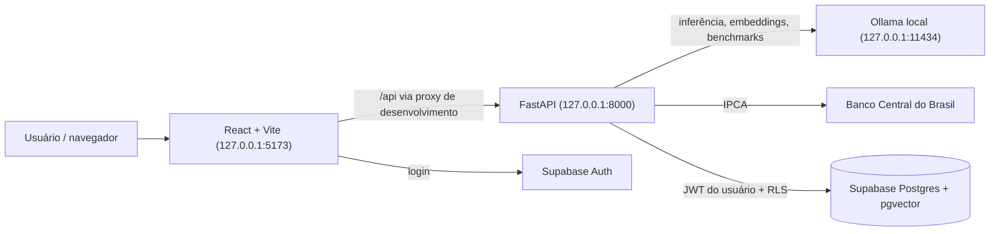

# Atlas AI · Agent Studio

**Plataforma experimental de Engenharia de IA**, desenvolvida em Python e React, que combina agentes com ferramentas, análise de dados, séries temporais, pesquisa documental com RAG e avaliação de LLMs locais.

> **Estado:** protótipo funcional para estudos e portfólio. A execução é **local**; não há demonstração pública hospedada. Resultados de previsão e respostas de IA exigem revisão humana antes de qualquer decisão relevante.

## Visão geral

O Atlas AI reúne cinco módulos integrados em uma interface web. A inferência de linguagem é feita localmente via **Ollama**; o **Supabase** é usado para autenticação e persistência quando configurado.

| Módulo | O que demonstra | Tecnologias principais |
| --- | --- | --- |
| **Agent Studio** | Chat com ferramentas Python autorizadas, contexto e registro de conversas | Python, FastAPI, Ollama |
| **Economics** | Consulta de IPCA do Banco Central, previsões e validação temporal | Python, séries temporais, backtesting |
| **Data Analyst** | Importação de CSV/XLSX e perguntas sobre tabelas | Pandas, OpenPyXL, ferramentas analíticas |
| **Deep Research** | Ingestão de PDF/TXT/MD, busca semântica e respostas com fontes | Ollama embeddings, Supabase, pgvector |
| **Model Lab** | Benchmarks controlados de modelos locais com métricas de tempo e desempenho | Ollama API, avaliação de LLMs |

A interface também oferece telas de **Modelos**, **Auditoria** e **Histórico** para inspecionar previsões e execuções.

## Arquitetura



O backend valida o JWT pelo Supabase quando a integração está configurada. O acesso aos registros persistentes utiliza o token do usuário e políticas de **Row Level Security (RLS)**, sem chave `service_role` no navegador.

Leia [Arquitetura](docs/ARQUITETURA.md) para os fluxos de dados, limites e decisões técnicas.

## Tecnologias

**Backend:** Python 3, FastAPI, Pydantic, Pandas, HTTPX, Uvicorn e Pytest.
**Frontend:** React 18, Vite 6, JavaScript, Lucide e React Markdown.
**IA e dados:** Ollama, `qwen3:4b-instruct`, `nomic-embed-text`, embeddings vetoriais e pgvector.
**Infraestrutura local:** PowerShell, Git, Node.js e Supabase opcional para parte das funcionalidades.

## Execução local no Windows

Pré-requisitos: **Python**, **Node.js/npm**, **Git** e **Ollama** instalados. Para usar login, histórico persistente e Deep Research, configure também um projeto **Supabase**.

### 1. Clonar e preparar o backend

```powershell
git clone https://github.com/TeusCarvalho/atlas-ai.git
cd atlas-ai
py -m venv .venv
.\.venv\Scripts\python.exe -m pip install -r requirements.txt
```

### 2. Preparar os modelos Ollama

```powershell
ollama pull qwen3:4b-instruct
ollama pull nomic-embed-text
```

O primeiro modelo atende o Assistente e o RAG. O segundo gera embeddings para pesquisa documental. Outros modelos instalados podem ser avaliados no Model Lab, conforme sua compatibilidade.

### 3. Configurar o ambiente

Copie os exemplos de configuração, **sem colocar chaves reais no Git**:

```powershell
Copy-Item .env.example .env
Copy-Item frontend\.env.example frontend\.env.local
```

Configure os valores em `.env` e `frontend/.env.local` usando a URL HTTPS do seu projeto Supabase e uma **publishable key**. Não use `service_role`, `sb_secret_` nem credenciais administrativas no frontend.

Para uma instalação **nova** de Supabase, revise os arquivos `supabase/schema.sql` e `supabase/rag_v10.sql`, aplicando-os ao projeto correto por meio do SQL Editor. **Não reaplique essas configurações indiscriminadamente a bancos existentes**; faça migrações controladas. A instalação local sem Supabase permite funcionalidades limitadas, mas não o Deep Research persistente.

### 4. Iniciar o backend

No terminal do PyCharm ou PowerShell, a partir da raiz:

```powershell
powershell.exe -NoProfile -ExecutionPolicy Bypass -File .\start_api_windows.ps1
```

Verifique a API em http://127.0.0.1:8000/docs ou execute:

```powershell
Invoke-RestMethod http://127.0.0.1:8000/api/health
```

### 5. Iniciar o frontend

Em outro PowerShell:

```powershell
cd frontend
npm.cmd ci
npm.cmd run dev
```

Abra **http://127.0.0.1:5173**. O uso de `npm.cmd` evita o bloqueio de `npm.ps1` em instalações do Windows com execução de scripts restrita.

> O frontend e a API são servidores de desenvolvimento. **Não exponha as portas 5173, 8000 ou 11434 à internet.**

## Como demonstrar o projeto

1. **Assistente:** perguntar a variação percentual de 200 para 300; resposta esperada: **50%**.
2. **Economics:** analisar 60 meses do IPCA e prever três competências; comparar a previsão com o backtesting. As projeções são experimentais, **não oficiais**.
3. **Atlas Data:** importar `exemplos/vendas_exemplo.csv` e fazer perguntas sobre a tabela.
4. **Deep Research:** importar `exemplos/manual_operacional_rag.md`, fazer uma pergunta respondível e outra sem evidências para avaliar a abstenção.
5. **Model Lab:** executar os quatro cenários em `qwen3:4b-instruct`, começando com uma repetição.

O benchmark do Model Lab verifica critérios específicos (instrução, escolha de ferramenta, fidelidade a contexto fornecido e abstenção). **Não constitui avaliação geral da inteligência do modelo**. O cenário de contexto simula RAG; não mede a recuperação pgvector.

## Qualidade e testes

```powershell
# Na raiz do projeto
.\.venv\Scripts\python.exe -m pytest -q

# Na pasta frontend
npm.cmd run build
npm.cmd audit
```

Na preparação da versão 12, **128 testes automatizados Python** passaram no ambiente de desenvolvimento. Em teste local no Windows, o build de produção concluiu e `npm audit` retornou **zero vulnerabilidades detectadas naquele momento**. Esses resultados não substituem testes de segurança ou de regressão para futuras versões.

Há também validações manuais de interface, login com duas contas, respostas do RAG, consulta do histórico e respostas 401 para endpoints sem autenticação. **O teste direto de autorização cruzada entre contas via API ainda está pendente**.

Consulte [Validação](docs/VALIDACAO.md) para o checklist e os limites do que foi testado.

## Privacidade, segurança e limites

- A interface e o Ollama rodam localmente; a **persistência no Supabase usa a nuvem**.
- O Deep Research **não armazena o arquivo original no Supabase**, mas armazena **trechos de texto extraídos e embeddings**. Evite documentos confidenciais ou dados pessoais sem avaliação adequada.
- O Atlas Data mantém o arquivo enviado na memória da sessão local; o histórico remoto armazena metadados e resultados resumidos, não a planilha original.
- Resultados de agentes, previsões e buscas semânticas podem falhar; referências e percentuais de similaridade não equivalem à garantia de acerto.
- A publicação do **código** no GitHub é diferente de hospedar a aplicação; a arquitetura atual foi desenhada para desenvolvimento local.

Leia [Segurança](docs/SEGURANCA.md) antes de abrir o repositório ou disponibilizar o serviço publicamente.

## Estrutura do repositório

```text
atlas-ai/
├── backend/             # API, autenticação, RAG e Model Lab
├── frontend/            # React e Vite
├── supabase/            # Esquema SQL e configuração de RLS/RAG
├── tests/               # Testes automatizados
├── exemplos/            # Arquivos fictícios/de demonstração
├── docs/                # Arquitetura, segurança e validação
├── atlas_agent.py       # Agente e ferramentas
├── atlas_pipeline.py    # Pipeline econômico
├── data_analysis.py     # Leitura e indicadores tabulares
├── dataset_agent.py     # Consultas sobre dados
├── requirements.txt
└── README.md
```

## Próximas melhorias

- Testes diretos de autorização entre duas contas e de comportamento de RLS em endpoints.
- Avaliação sistemática do RAG com conjunto de perguntas rotuladas e métricas.
- Observabilidade de latência e rastreamento de chamadas de IA.
- Aprimoramentos de UX, streaming e controles de execução.
- Estratégia de implantação com autenticação e rede segura, **antes** de disponibilizar backend e inferência remotamente.

## Documentação

- [Arquitetura e fluxos](docs/ARQUITETURA.md)
- [Segurança e privacidade](docs/SEGURANCA.md)
- [Testes, evidências e pendências](docs/VALIDACAO.md)

---

**Atlas AI é um projeto educacional e demonstrativo de Engenharia de IA.** Não oferece previsões oficiais, consultoria financeira ou garantias de resposta correta.
