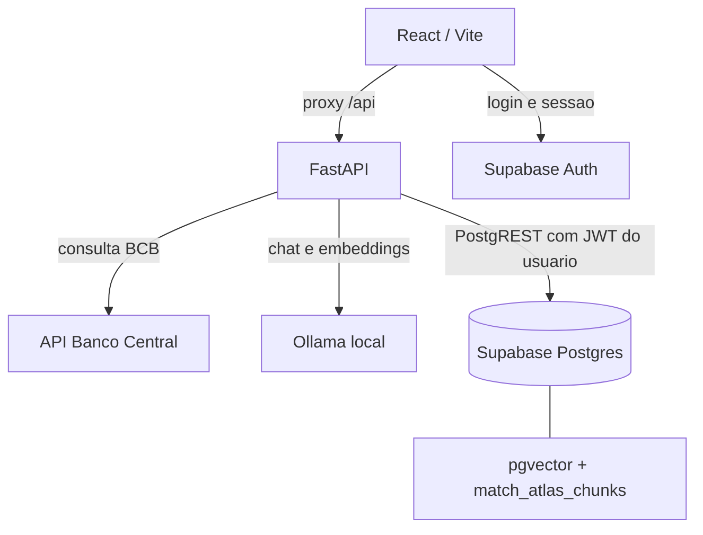
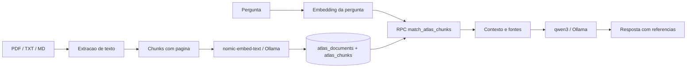

# Arquitetura do Atlas AI

## Objetivo e topologia

O Atlas AI é uma aplicação **local-first**, com interface React, API FastAPI e inferência via Ollama. O Supabase é utilizado como serviço externo opcional de identidade e persistência; já o Banco Central do Brasil fornece dados públicos de IPCA ao pipeline econômico.

### Componentes

| Diretório / arquivo | Responsabilidade |
| --- | --- |
| `frontend/src/App.jsx` | Navegação, Economia, histórico e Assistente |
| `frontend/src/DataPanel.jsx` | Importação e consultas de dados |
| `frontend/src/ResearchPanel.jsx` | Experiência de RAG |
| `frontend/src/ModelLabPanel.jsx` | Avaliação de modelos |
| `frontend/src/AuthGate.jsx` | Entrada/cadastro Supabase |
| `backend/api.py` | Rotas FastAPI, sessões e dependência de autenticação |
| `backend/auth_store.py` | Validação de usuário e persistência com JWT próprio |
| `backend/research.py` | Extração, chunking, embedding e recuperação vetorial |
| `backend/model_lab.py` | Benchmark de modelos e medições |
| `atlas_agent.py` | Assistente com Ollama e ferramentas Python autorizadas |
| `atlas_pipeline.py` | Execução do pipeline de previsão e validação |
| `data_analysis.py` / `dataset_agent.py` | Processamento e consultas de CSV/XLSX |

## Fluxos principais

### Chat do Assistente

1. A interface cria uma sessão por `POST /api/session`.
2. O frontend envia pergunta em `POST /api/chat` com sessão ativa e credencial, quando configurada.
3. O backend valida a identidade, executa o agente no Ollama e pode acionar ferramentas Python autorizadas.
4. Com Supabase configurado, a pergunta e a resposta são gravadas na tabela `atlas_messages` com `user_id` do usuário autenticado.

A sessão de trabalho é mantida **em memória no backend** e pode expirar. O histórico de mensagens é persistido separadamente.

### Economia

1. `POST /api/analyze` recebe histórico e horizonte dentro dos limites de validação.
2. O pipeline consulta dados oficiais do IPCA, produz diagnóstico e experimentos de previsão.
3. O frontend mostra tabelas e gráficos; os resultados resumidos são gravados em `atlas_runs` quando há autenticação Supabase.
4. As projeções não devem ser interpretadas como números oficiais do IBGE ou do Banco Central.

### Atlas Data

1. `POST /api/data/upload` aceita CSV ou XLSX e lê o arquivo na memória da sessão.
2. O backend calcula metadados e métricas da tabela, descartando o arquivo original após a leitura.
3. `POST /api/data/ask` executa perguntas sobre o DataFrame já carregado, sem exigir reenvio do arquivo nessa mesma sessão.
4. Somente metadados/resumos e mensagens ficam no histórico persistido; o DataFrame não é armazenado no Supabase por esse fluxo.

Limites do código atual: **8 MB por arquivo** e cerca de **40 MB de memória estimada para o DataFrame** por sessão.

### Deep Research (RAG)

**Ingestão:** os PDFs são processados como texto extraível, **sem OCR**. A aplicação aceita até **2 MB por arquivo**, **60 páginas**, **100 mil caracteres** e **160 chunks**. O texto é dividido em trechos de aproximadamente **850 caracteres**, com sobreposição de **100 caracteres**. O modelo de embeddings padrão é `nomic-embed-text` com **768 dimensões**.

**Persistência:** o Supabase guarda **texto extraído e embeddings**, não o arquivo original. A RPC `match_atlas_chunks` usa `SECURITY INVOKER` e escopo de usuário para recuperar trechos. O modelo recebe os trechos selecionados com a referência de arquivo/página; o resultado ainda está sujeito a erros e alucinações.

### Model Lab

O módulo consulta os modelos Ollama instalados e executa quatro cenários: instruções, tool calling, fidelidade a um contexto fornecido e abstenção. Pode testar **até dois modelos**, com **até duas repetições** por modelo. São reportados tempos, quantidade de tokens e métricas fornecidas pelo Ollama. **O Model Lab não salva os benchmarks no Supabase.**

O cenário contextual é um **teste sintético** e não passa pelo mecanismo pgvector do Deep Research.

## Identidade, permissões e rede

- Em modo Supabase, `require_actor` valida o `Bearer` por `/auth/v1/user` antes de acessar rotas protegidas.
- `auth_store.py` usa uma publishable key + JWT do usuário; não utiliza privilégios administrativos para acessar tabelas.
- Todas as tabelas da aplicação em `public` possuem RLS com políticas de propriedade por `user_id`.
- O backend está configurado para `127.0.0.1:8000`; o Vite para `127.0.0.1:5173`; o Ollama é consumido via `127.0.0.1:11434` por padrão.
- A aplicação **não está desenhada para exposição direta na internet**. Hospedagem futura exigirá uma revisão completa de arquitetura, autenticação, limites e transporte.

Mais detalhes em [Segurança](SEGURANCA.md) e [Validação](VALIDACAO.md).
